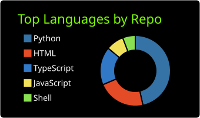
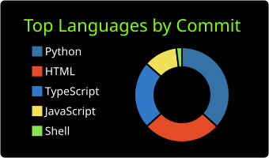

# Martin Kaiser

### AI/ML Engineer · PhD Physics · Berlin

**I build LLM agents and evidence-bound document pipelines — and measure whether they work.**

 

| 🏆 **7 wins · 13 podiums** | 🦊 **Awesome MCP Servers** | 🔬 **Top 10%** | 💰 **Grant winner** |
|:--:|:--:|:--:|:--:|
| hackathons 2025–2026 · **15 top finishes** | kitsune-mcp listed · ~2.8k downloads/mo | Apart Research sprint, 230+ projects | mloda open-source plugin grant |

**🎯 Open to:** hackathon teams · open-source collabs on agents & LLM tooling — Berlin or remote

 

## 📦 Open source in use

### 🦊 [kitsune-mcp](https://github.com/kaiser-data/kitsune-mcp) — hot-reload for MCP servers

Your agent edits an MCP tool, calls `reload("dev")` and tests the fix in the same session, with no client restart. It also mounts any of **130,000+ servers from 7 registries** mid-session, and runs community packages inside a hardened Docker cage.

Merged into [punkpeye/awesome-mcp-servers](https://github.com/punkpeye/awesome-mcp-servers) (97k★, Oct 2026) · v0.22, 270+ commits, CI + coverage · `claude mcp add -s user kitsune -- uvx kitsune-mcp`

| Tool | What it does |
|:--|:--|
| [`free-llm-proxy-router`](https://github.com/kaiser-data/free-llm-proxy-router) | One Go binary turns every free LLM tier (Groq, Gemini, OpenRouter, Cerebras, GitHub Models…) into a single OpenAI-compatible endpoint with automatic fallback |
| [`claude-code-langfuse-tracing`](https://github.com/kaiser-data/claude-code-langfuse-tracing) | A Stop hook replays Claude Code transcripts into Langfuse as backdated, session-grouped traces with token and cost; fail-open, secret in the macOS Keychain |
| [**Astrolab**](https://github.com/kaiser-data/github-stars-analyzer) · [▶ Live](https://star-astrolab.vercel.app) | Your GitHub stars as a decision tool: **2,400+ starred repos** in a 3D knowledge graph (39 communities), health and lifecycle scores, and **29 landscape reports** that answer *"which tool should I use for X?"*. Built offline, no LLM in the hot path, refreshed weekly |

 

## ⭐ Highlights

| | Project | Why it matters | |
|:--|:--|:--|:--|
| 🥈 | **Friends with Benefits** *(private)* 2nd · Stripe × Supabase Hack Berlin · Oct 2026 | One sentence from a shop owner becomes a booking page with an ambassador crew. Rewards fire only on a real Stripe payment, so fake sign-ups farm nothing | [▶ Live](https://www.friends-with-benefits.quest) |
| 🥇 | **[reaction-dynamics](https://github.com/kaiser-data/reaction-dynamics)** 1st · Cognee × Qdrant Hack Night · solo | Team-behavior analytics from Slack reaction timing: KS-test classifier + Cognee/Qdrant knowledge graph | [▶ Live](https://reaction-dynamics-berlin.netlify.app) · [graph](https://reaction-dynamics-berlin.netlify.app/graph.html) |
| 🇨🇭 | **[Büchli](https://github.com/kaiser-data/hack-apertus-booklet-nli)** Hack Apertus 2026 · Track 2A · Oct 2026 | Checks campaign claims against the Swiss voting booklet in DE/FR/IT with Apertus 70B. **0.930 macro-F1** on 976 claims from 14 unseen vote dates, at **1/9 the tokens** of whole-booklet prompting | |
| 🏅 | **GLiNER2 action classifier** *(private)* Top 10% · Apart AI Incident Response Sprint · Sept 2026 | A fine-tuned 307M encoder flags agent action commitments in **18 ms vs 520 ms** for a hosted Qwen baseline, catching 14 of 15 actions vs 10 — a high-recall tripwire for agent monitoring | |
| 🎤 | **[Sayproof](https://github.com/kaiser-data/sayproof)** Nebius × NVIDIA Global AI Hackathon · Sept 2026 | Fact-check a talk before the audience does: every verdict quotes its source verbatim, or says "can't verify". Nemotron 120B + Tavily | [▶ Live](https://sayproof.vercel.app) |

More live: [fraudmind](https://fraudmind.netlify.app) — fraud hunting over GDPdU audit dossiers, 22 rule families · [Soteria on Monad](https://soteria-monad-rho.vercel.app) — incident receipts on chain · [LLM pricing audit](https://llm-pricing-audit.pages.dev)

 

## 🏆 Track record

**7 wins · 13 podiums · 15 top finishes · 2025–2026**

### 2026 — 3 wins · 7 podiums · 9 top finishes

| Result | Event | Project / Track |
|:--|:--|:--|
| 🥇 **1st place** | **[Cognee × Qdrant Hack Night](https://luma.com/cognee-m078)** · Berlin | *[reaction-dynamics](https://github.com/kaiser-data/reaction-dynamics)* — solo entry |
| 🥇 **1st place** | **Agentic FinAI Hackathon** · Berlin | Dify Open Track |
| 🏆 **Track winner** | **AI Agents Hackathon** · Berlin | Blockchain for Good Alliance Bonus Track |
| 🥈 **2nd place** | **Stripe × Supabase Hack: AI Payments for the Real Economy** · Berlin | *[Friends with Benefits](https://www.friends-with-benefits.quest)* |
| 🥈 **2nd place** | **AI Builders Open Claw Hackathon** | Open Claw |
| 🥉 **3rd place** | **[Collaborative Agent Hackathon](https://github.com/kaiser-data/Soteria)** · Flower Labs, Berlin | *[Soteria](https://github.com/kaiser-data/Soteria)* — privacy-preserving multi-party incident response |
| 🥉 **3rd place** | **Needle Hackathon** | Main Track |
| 🏅 **Runner-up · 4th place** | **Superchat × Needle AI Builder Event** | Salesbot |
| 🏅 **Top-7 finalist** | **Cognee AI-Memory Hackathon** | Finals |

### Research & grants

| Result | Programme | Project |
|:--|:--|:--|
| 🏅 **Top 10%** of 230+ | **[Apart](https://apartresearch.com) AI Incident Response Sprint** · Containment · Sept 2026 | *GLiNER2 as a fast action classifier for agent monitoring* *(private)* |
| 💰 **Grant winner** | **[mloda](https://mloda.ai) monthly plugin grant** · Sept 2026 | *mloda-gdpdu-provenance* *(private)* — a total that names its rows, or no total |
| 📝 Submitted | **Apart AI Collusion Sprint** · Track 2 · Oct 2026 | *[auditing-llm-pricing-agents](https://github.com/kaiser-data/auditing-llm-pricing-agents)* — legal price rules mimic the punish-and-recover pattern collusion audits look for |
| 📝 Submitted | **Apart Digital Minds Sprint** · Aug 2026 | *[Coherence Without Content](https://github.com/kaiser-data/do_models_have_minds)* — a missing content control for preference-coherence metrics |
| 📝 Submitted | **Apart Secret Loyalties Hackathon** · Berlin, July 2026 | *[secret-localities-strategies](https://github.com/kaiser-data/secret-localities-strategies)* — activation forensics for hidden loyalties |

<b>2025 — 4 wins · 6 podiums</b> (click to expand)

 

| Result | Event | Project / Track |
|:--|:--|:--|
| 🥇 **1st place** | **ElevenLabs Hackathon** | n8n Category |
| 🥇 **1st place** | **NEAR AI Hackathon** | Shade AI-Agent |
| 🥇 **1st place** | **AI Hardcore Hackathon** | LLM Prediction |
| 🥇 **1st place** | **Masterschool Hackathon** | SMS-Service |
| 🥈 **2nd place** | **Distributed AI Hack Berlin** | Open Track |
| 🥈 **2nd place** | **IronHack DevOps Hackashow** | DevOps |

 

## 🗂️ More projects

A slice of 189 repos (127 public).

**🧩 Agents & LLM apps**
- [`Soteria`](https://github.com/kaiser-data/Soteria) — 🥉 federated multi-party incident response on Flower; parties answer with traffic lights, never raw values; two-key human approval, chained receipts
- [`fraudmind`](https://github.com/kaiser-data/fraudmind) — deterministic fraud hunting over GDPdU audit dossiers; 22 rule families + Cognee graph, "no number without a source"
- [`AngebotsBot`](https://github.com/kaiser-data/AngebotsBot) — AI deal scanner: kaufda.de + Qwen VL 32B + Supabase + LangGraph + Telegram
- [`carlover`](https://github.com/kaiser-data/carlover) · [`multi-agent-research`](https://github.com/kaiser-data/multi-agent-research) — LangGraph multi-agent assistants

**⚡ Edge & self-hosted AI**
- [`jetson-headless-inference`](https://github.com/kaiser-data/jetson-headless-inference) — Jetson Orin 8GB headless AI API with model switching & power management
- `comm-buddy` *(private)* — local-first meeting analysis: whisperX + pyannote + Ollama across Mac + Jetson over Tailscale
- [`mac-ram-manager`](https://github.com/kaiser-data/mac-ram-manager) · [`cleandrive`](https://github.com/kaiser-data/cleandrive) — zero-dependency macOS system tools

<b>📊 ML & benchmarking · 🔁 Automation & infra</b> (click to expand)

 

**📊 ML & benchmarking**
- [`featherless-bench`](https://github.com/kaiser-data/featherless-bench) — systematic LLM benchmarking + DeepEval; Pareto frontier, Vision Arena, 19 text models
- [`llm-finetune-kit`](https://github.com/kaiser-data/llm-finetune-kit) — beginner-friendly LLM fine-tuning: 3-line training, web UI, smart defaults
- [`berlin25-eurosat`](https://github.com/kaiser-data/berlin25-eurosat) — federated learning (Flower) on EuroSAT satellite imagery

**🔁 Automation & infra**
- [`inbox-inferno-n8n`](https://github.com/kaiser-data/inbox-inferno-n8n-community-challenge) — AI email agent with LLM-as-judge — scored **20/20**
- [`aws-terraform-devops-infrastructure`](https://github.com/kaiser-data/aws-terraform-devops-infrastructure) — AWS VPC infrastructure defined with Terraform
- [`kaiser-echo`](https://github.com/kaiser-data/kaiser-echo) — bilingual voice agent with memory (React + Cloudflare Workers)

 

## 🤖 How I work with Claude Code

Claude Code is my daily driver. Each layer below does one job, and I measure the result instead of guessing:

| Layer | What it does in my sessions |
|:--|:--|
| **[superpowers](https://github.com/obra/superpowers)** | The process: brainstorm → written plan → test-first → verify with evidence before anything is called done |
| **[ECC](https://github.com/affaan-m/ECC)** | Code-quality rules for Python and TypeScript, switched on per session when I write or review code |
| **[claude-mem](https://github.com/thedotmack/claude-mem)** | Memory across sessions: what was tried, decided and shipped, so a new session starts where the last one stopped |
| **[32 public skills](https://github.com/kaiser-data/marty-skills)** of my own | Built with my `skill-forge`, mostly research methodology learned the hard way in eval sprints: `systematic-study`, `seed-replicates-before-effects`, `detection-needs-a-denominator`, `numbers-from-primary-sources` |

Numbers from my own [Langfuse tracing](https://github.com/kaiser-data/claude-code-langfuse-tracing), 30 days to September 2026:

| Traces | Observations | Tokens (30d) | Models in rotation |
|:------:|:------------:|:------------:|:------------------:|
| **1.45K** | **18.4K** | **~1.7B** | Opus 4.8 · Sonnet 5 · Haiku 4.5 · Fable 5 |

- 🦊 [`kitsune-mcp`](https://github.com/kaiser-data/kitsune-mcp) and 🔭 [`claude-code-langfuse-tracing`](https://github.com/kaiser-data/claude-code-langfuse-tracing) — see [Open source in use](#-open-source-in-use)
- 📡 [`claude-A2A-Comm`](https://github.com/kaiser-data/claude-A2A-Comm) — A2A-protocol messaging between Claude Code sessions, local or over a Pi/VPS hub
- 🧰 [`kogitsune`](https://github.com/kaiser-data/kogitsune) — my session launcher: starts each project with a lean kit of skills and plugins, so sessions spend fewer tokens

 

## 💡 Tech stack

 

## 🎭 Beyond code

🎤 **VP Public Relations** · Toastmasters Club Berliner Rhetorikmeister 
♟️ **Teams Organizer** · Chessclub Weisse Dame e.V. *(200 members)*

 

## 📊 GitHub

<!-- Reliable badges (always render) -->

  

<!--
  All stat cards are STATIC SVGs committed to this repo (never live-rendered),
  so they can't hit the rate limits that broke the old cards:
   - stats-card.svg : custom card: github-readme-stats rank (formula ported 1:1 in
     scripts/generate-stats-card.mjs), key figures
     and a 52-week heatmap. Refreshed daily by .github/workflows/stats-card.yml
     (needs the STATS_TOKEN secret).
   - language donuts : github-profile-summary-cards, theme chartreuse_dark,
     refreshed daily by .github/workflows/profile-summary-cards.yml.
-->

Hover every day and drag the inputs to see how the rank responds: <b><a href="https://kaiser-data.github.io/kaiser-data/">interactive version</a></b>

<b>How the rank is computed</b> (click to expand)

 

The rank uses the formula from [github-readme-stats](https://github.com/anuraghazra/github-readme-stats/blob/master/src/calculateRank.js), ported unchanged. Each input is scored against a fixed median and weighted; the weighted share sets the percentile and the letter.

| Input | Median | Weight |
|:--|--:|--:|
| Commits, last 12 months | 250 | 2 |
| Pull requests, all time | 50 | 3 |
| Issues, all time | 25 | 1 |
| PR reviews, last 12 months | 2 | 1 |
| Stars on owned repos | 50 | 4 |
| Followers | 10 | 1 |

Levels by percentile: **S** ≤ 1 · **A+** ≤ 12.5 · **A** ≤ 25 · **A-** ≤ 37.5 · **B+** ≤ 50 · **B** ≤ 62.5 · **B-** ≤ 75 · **C+** ≤ 87.5 · **C** otherwise.

**What the letter does not measure:** its "percentile" compares inputs against fixed medians, not against real users, and stars carry a third of the weight, so activity alone tops out around A-. For a measured comparison, 400 random GitHub accounts were sampled (Nov 2026): none had as many contributions in the last 12 months as this profile, which puts it in the **top 1 %** at 95 % confidence.

 

  

💬 Berlin-based · open to hackathon teams and open-source collabs — <a href="mailto:martinkaiser.bln@gmail.com">martinkaiser.bln@gmail.com</a>

